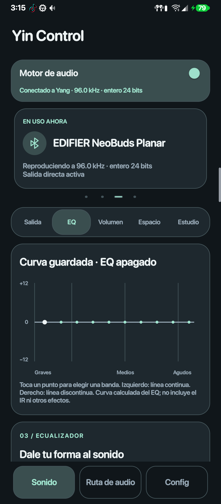
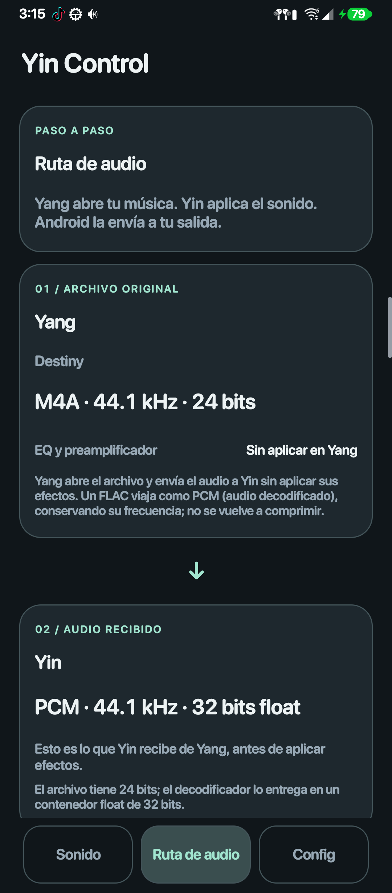
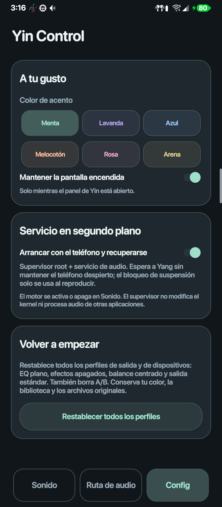

<p align="center"></p>
<h1 align="center">Yin Control</h1>
<p align="center">El motor detrás del sonido.</p>
<p align="center"><b>Android 12+ · ARM64 · Java · FFmpegKit · Root / LSPosed</b></p>
<p align="center"><a href="https://github.com/zXer0z/Yang-Player">Conoce Yang Player</a> · <a href="#compilar">Compilar</a> · <a href="docs/yin-dsp.md">Procesamiento de audio</a></p>

Yin es el motor de audio complementario de **[Yang Player](https://github.com/zXer0z/Yang-Player)**. Recibe PCM mediante un puente autenticado, procesa el sonido y administra su salida. Yang mantiene la biblioteca y la interfaz; Yin concentra los controles avanzados y la integración de audio específica del dispositivo.

## Así se ve

Capturas reales del panel.

<table><tr><th>Sonido</th><th>Ruta de audio</th><th>Configuración</th></tr>
<tr><td></td><td></td><td></td></tr></table>

## Qué incluye

- Perfiles por conexión y selección opcional por dispositivo reconocido.
- EQ gráfico y paramétrico de diez bandas, con ganancia, frecuencia, Q y destino por canal.
- Preamplificador, control de margen y picos, remuestreo y tamaño del búfer.
- Importación local de correcciones AutoEQ/Equalizer APO y convolución mediante WAV/IRS compatibles.
- Graves dinámicos, compresor, crossfeed, espacio estéreo y ajustes tonales.
- Cadena de efectos ordenable, controles de canales y medidores PCM de entrada/salida.
- Pantallas de Sonido, Ruta y Configuración; personalización de apariencia y supervisor opcional para el servicio.
- Un puente que verifica el certificado de Yang antes de aceptar la sesión de audio.

Los controles documentados corresponden al código actual; los efectos dependen de la ruta y del formato. Las etapas que no son compatibles se omiten o se indican en el panel. La documentación de [DSP](docs/yin-dsp.md) explica el orden y los límites.

## Compatibilidad

El desarrollo se centra en **LG V60 ThinQ**, ARM64 y ROM stock. El APK requiere Android 12 o posterior. Las funciones root y los hooks de LSPosed son específicas de la ROM y del hardware: instalar el APK en otro teléfono no implica disponer del mismo DAC, de las mismas rutas o de los mismos controles.

Yin es un servicio Android con procesamiento propio; no se presenta como un controlador universal de DAC ni como prueba de reproducción bit-perfect. Los medidores PCM no miden presión sonora. Si Yang espera a Yin, conserva esa espera en lugar de pasar automáticamente a una salida sin sus efectos.

## Compilar

Este repositorio incluye su código nativo, el contrato del puente y las dependencias de compilación. No necesita la carpeta original `MP3_player` ni una copia vecina de Yang.

**Requisitos:** JDK 17, Android SDK 36, Build Tools 36.0.0 y NDK r27c (`27.2.12479018`). Configura `JAVA_HOME` y `ANDROID_HOME`, o un `local.properties` propio con la ruta del SDK.

```powershell
git clone https://github.com/zXer0z/Yin-Control.git
cd Yin-Control
./tools/Prepare-DebugSigning.ps1
# Si no tienes el NDK instalado en el SDK:
./tools/Fetch-Ndk.ps1
./gradlew.bat :app:assembleRelease --console=plain
```

APK: `app/build/outputs/apk/release/app-release.apk`. Se incluye `gradlew` para Unix y se admite un NDK existente con `-PndkPath=RUTA_AL_NDK`.

Los builds públicos de desarrollo usan el keystore estándar de Android de tu equipo, preparado por el script si falta. No se incluyen claves privadas. Compila Yang y Yin con ese mismo keystore para que sus huellas predeterminadas coincidan. Con firmas diferentes, configura `-PyangCertSha256=HUELLA_SHA256_DE_YANG` al compilar Yin y `-PyinCertSha256=HUELLA_SHA256_DE_YIN` al compilar Yang. Los certificados se comprueban en ambas direcciones; instalar un build con otra firma no actualiza automáticamente un APK ya instalado con distinta clave.

Para utilizar las funciones privilegiadas se necesita el entorno root/LSPosed compatible y la configuración correspondiente en el teléfono. La instalación de esas herramientas queda fuera de este repositorio.

## Estructura

| Pieza | Responsabilidad |
|---|---|
| `app/src/main/java/local/v60/player/` | Servicio, panel, DSP, salida y controles del dispositivo |
| `app/src/main/cpp/` | Integración nativa ARM64 |
| `shared/yin-bridge/` | Protocolo del puente con Yang |
| `app/libs/` | Artefactos de FFmpegKit, Smart Exception y API de compilación Xposed |
| `docs/` | DSP, ruta, límites y dependencias |

[DSP y controles](docs/yin-dsp.md) · [Ruta de audio](docs/yin-route.md) · [Límites por dispositivo](docs/yin-device-limits.md) · [Puente con Yang](docs/yin-bridge.md).

## Dependencias y avisos

FFmpegKit Audio 8.1.7 y Smart Exception 0.2.1 conservan las licencias y avisos de sus proyectos. La API de Xposed es solo de compilación y no se empaqueta. Consulta [THIRD_PARTY.md](docs/THIRD_PARTY.md), [las huellas SHA-256](docs/dependency-sha256.json) y [los avisos del APK](app/src/main/assets/licenses).

Se incluyen los artefactos de desarrollo para reproducir la construcción, con sus proyectos de origen documentados. No se publican firmware, bibliotecas propietarias del teléfono, claves de firma ni datos personales del dispositivo. Las comprobaciones funcionales y de escucha se realizan manualmente en el teléfono.
