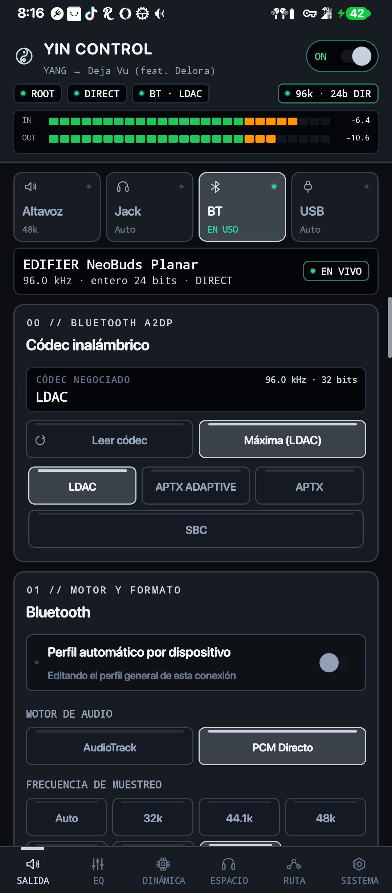
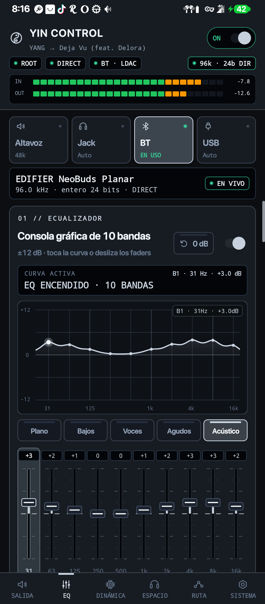
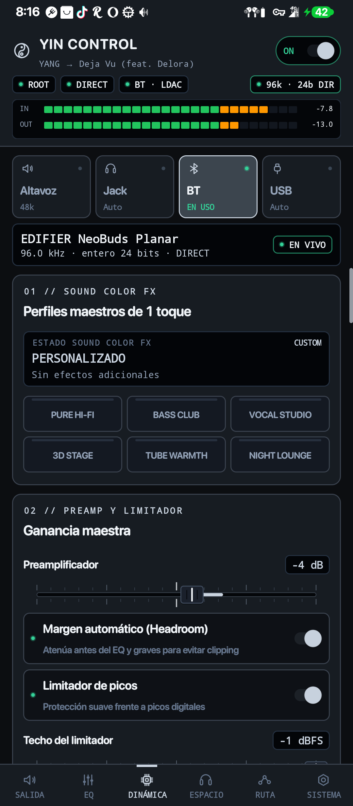
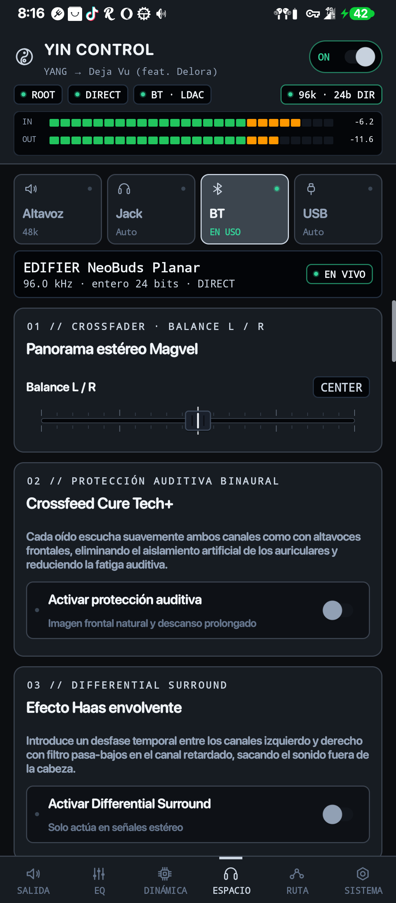
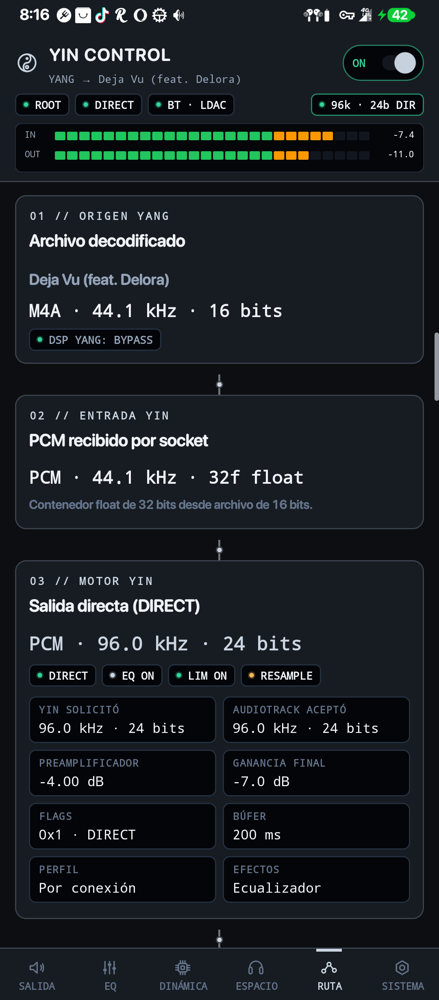
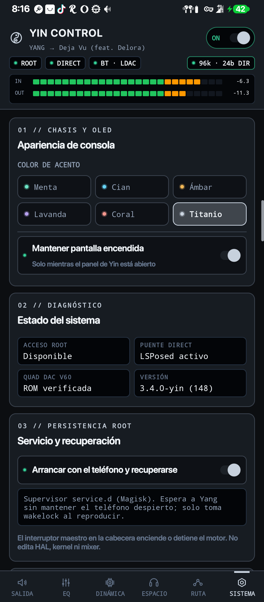

<p align="center"></p>
<h1 align="center">Yin Control · v3.4.0-yin</h1>
<p align="center">Consola hardware DSP y motor de audio root para Yang Player.</p>
<p align="center"><b>Android 12+ · ARM64 · Java 17 · FFmpegKit f64 · Root / LSPosed · LG V60 ThinQ</b></p>
<p align="center">
  <a href="https://zxer0z.github.io/Yin-Control/">Web Showcase (Astro)</a> ·
  <a href="https://github.com/zXer0z/Yang-Player">Yang Player</a> ·
  <a href="#compilar">Compilar</a> ·
  <a href="docs/yin-dsp.md">Arquitectura DSP</a>
</p>

**Yin Control** (`local.v60.player`) es el motor de audio root y consola DSP/DAC complementaria de **[Yang Player](https://github.com/zXer0z/Yang-Player)**. Recibe PCM sin pérdida a través de un puente autenticado por firma SHA-256 + Binder + Unix socket, ejecuta una cadena FFmpeg `f64` en tiempo real y entrega la salida directa (`PCM DIRECT`, LG V60 ESS Quad DAC, USB DAC o Bluetooth A2DP LDAC 96 kHz).

## Consola estilo DJ Mixer (v3.4.0-yin)

Rediseñada con estética de mesa de mezclas profesional: chasis negro OLED, **puente de vúmetros LED de 28 segmentos** en cabecera (`Verde → Ámbar → Rojo`), chips de estado hardware en vivo (`ROOT`, `DIRECT`, `BT · LDAC`, `kHz / bits`), **pantallas OLED empotradas**, **pads `SOUND COLOR FX` de 1 toque** y **faders lineales verticales/horizontales** sin perillas incómodas.

Capturas reales tomadas en **LG V60 ThinQ** con **Yang Player** reproduciendo por **LDAC 96 kHz / 24-bit DIRECT**:

<table>
  <tr>
    <th>SALIDA · Ruta &amp; LDAC</th>
    <th>EQ · Curva RBJ + Faders</th>
    <th>DINÁMICA · Sound Color FX</th>
  </tr>
  <tr>
    <td></td>
    <td></td>
    <td></td>
  </tr>
  <tr>
    <th>ESPACIO · Binaural &amp; Haas</th>
    <th>RUTA · Telemetría AudioFlinger</th>
    <th>SISTEMA · Chasis &amp; Root</th>
  </tr>
  <tr>
    <td></td>
    <td></td>
    <td></td>
  </tr>
</table>

## Qué incluye v3.4.0-yin

- **Navegación directa en 6 pestañas hardware:** `SALIDA`, `EQ`, `DINÁMICA`, `ESPACIO`, `RUTA` y `SISTEMA`.
- **Perfiles independientes por conexión + Auto-Perfil por dispositivo (SHA-256):** Altavoz, Jack/AUX, Bluetooth y USB DAC.
- **Equalizador gráfico/paramétrico de 10 bandas (`f64`):** Curva analítica RBJ interactiva en tiempo real, 10 faders verticales lineales (`GainFader`), editor paramétrico (`20–20 000 Hz`, `Q 0.1–12.0`, `PK / LS / HS`, canal `L / R / Ambos`) e importación local **AutoEQ / Equalizer APO**.
- **Convolver IR (FIR particionado):** Carga local de archivos `.wav` / `.irs` (hasta `2 s`, `16 MB`, `384 kHz`) con mezcla seca/húmeda y ganancia independientes.
- **`SOUND COLOR FX` (6 pads maestros de 1 toque):** `PURE HI-FI`, `BASS CLUB`, `VOCAL STUDIO`, `3D STAGE`, `TUBE WARMTH` y `NIGHT LOUNGE`.
- **Dinámica calibrada y calidez analógica:**
  - **Graves y Sub-Woofer:** modos `Natural`, `Sub-Woofer` (`asubboost`) y `Dinámico` adaptativo (`adynamicequalizer`), `40–160 Hz`, `+1..+12 dB`.
  - **Claridad y Detalle:** modos `Armónico` (`crystalizer`), `Presencia` y `Híbrido`.
  - **Compresor RMS** (`Suave 2:1`, `Estudio 3:1`, `Noche 6:1` o manual) + **Limitador de picos digitales** (`-12..-1 dBFS`).
  - **Calidez Analógica:** saturación soft-clip (`tanh` válvula, `atan` cinta, `cubic` clase A) con oversampling `2×`.
- **Laboratorio Espacial ViPER-grade (auriculares):**
  - **Protección Auditiva Binaural (Crossfeed Cure Tech+):** presets `Leve` (`700 Hz · 45%`), `Medio` (`700 Hz · 60%`), `Fuerte` (`650 Hz · 95%`) o ajuste fino para eliminar la fatiga auditiva en auriculares.
  - **Differential Surround (Efecto Haas):** retardo interaural `1–25 ms`, inversión de canal retardado (`Reverse L↔R`), mezcla `Wet/Dry 10–100%` y filtro pasa-bajos (`1.5–16 kHz`) que proyecta el sonido fuera de la cabeza.
  - **Panorama Magvel (`Balance L/R`)** + **Escena Estéreo Mid/Side** + **Calibración milimétrica por oído** (`±dB` y micro-retardo `0–20 ms` L/R).
- **Control hardware LG V60 & Root:** Ganancia del **ESS Sabre Quad DAC** (`Normal`, `Alta Impedancia`, `AUX`), selector root de códec Bluetooth A2DP (`LDAC 96 kHz`, `aptX Adaptive`, `aptX`, `SBC`), hook **LSPosed Direct** y supervisor opcional en `service.d` (Magisk) sin wakelock permanente.
- **Telemetría real en `RUTA`:** Seguimiento extremo a extremo desde el archivo en Yang hasta el socket PCM, AudioTrack (`FLAGS 0x1 · DIRECT`), `dumpsys media.audio_flinger` y `/proc/asound/.../hw_params`.

## Web Showcase Interactivo (`website/`)

Este repositorio incluye en [`website/`](website/) una landing page interactiva construida con **Astro** que reproduce la estética OLED/DJM de Yin Control e incluye un simulador en navegador (curva RBJ en Canvas, pads Sound Color FX, faders arrastrables, radar Haas/Binaural y sintetizador Web Audio API).

```powershell
cd website
npm install
npm run dev
```

## Compatibilidad

El desarrollo está centrado en **LG V60 ThinQ** (ARM64, Android 12+). Las funciones root (`Su` / Magisk) y hooks LSPosed (`DirectModule`) dependen de la ROM/hardware del dispositivo: instalar el APK en otros teléfonos no garantiza las mismas rutas ALSA/HAL ni control directo del Quad DAC.

Yin valida el certificado de Yang Player (`YANG_CERT_SHA256`) antes de abrir sesiones PCM. Los medidores de tablero miden niveles PCM digitales (`dBFS`), no presión sonora (`dB SPL`).

## Compilar

**Requisitos:** JDK 17, Android SDK 36, Build Tools 36.0.0 y NDK r27c (`27.2.12479018`). Configura `JAVA_HOME` y `ANDROID_HOME` o un `local.properties` con `sdk.dir`.

```powershell
git clone https://github.com/zXer0z/Yin-Control.git
cd Yin-Control
./tools/Prepare-DebugSigning.ps1
# Si no tienes el NDK r27c instalado en el SDK:
./tools/Fetch-Ndk.ps1
./gradlew.bat :app:assembleRelease --console=plain
```

APK resultante: `app/build/outputs/apk/release/app-release.apk`. Puedes apuntar a un NDK existente con `-PndkPath=RUTA_AL_NDK`.

Los builds públicos usan `~/.android/debug.keystore`. Compila **Yang Player** y **Yin Control** con el mismo keystore (o pasa `-PyangCertSha256=...` y `-PyinCertSha256=...` con las huellas SHA-256 correspondientes) para habilitar el puente autenticado.

## Estructura del repositorio

| Ruta | Responsabilidad |
|---|---|
| `app/src/main/java/local/v60/player/` | Consola DJM (`MainActivity`, `YinUi`, `MixerFaderView`, `YinIcons`), DSP, servicio y control root/HAL |
| `app/src/main/cpp/` | Biblioteca nativa JNI (`direct.c`) ARM64 con páginas flexibles |
| `shared/yin-bridge/` | Contrato Binder + protocolo IPC entre Yang Player y Yin Control |
| `app/libs/` | `ffmpeg-kit-audio-8.1.7.aar`, `smart-exception` y API compileOnly de Xposed |
| `website/` | Web showcase oficial en Astro con simulador interactivo de consola |
| `docs/` | Documentación de [DSP](docs/yin-dsp.md), [Ruta](docs/yin-route.md), [Límites V60](docs/yin-device-limits.md) y [Puente](docs/yin-bridge.md) |

## Dependencias y licencias

FFmpegKit Audio 8.1.7 y Smart Exception 0.2.1 conservan las licencias y avisos de sus proyectos. La API de Xposed se utiliza únicamente en compilación (`compileOnly`). Consulta [THIRD_PARTY.md](docs/THIRD_PARTY.md), [las huellas SHA-256](docs/dependency-sha256.json) y [los avisos del APK](app/src/main/assets/licenses).
